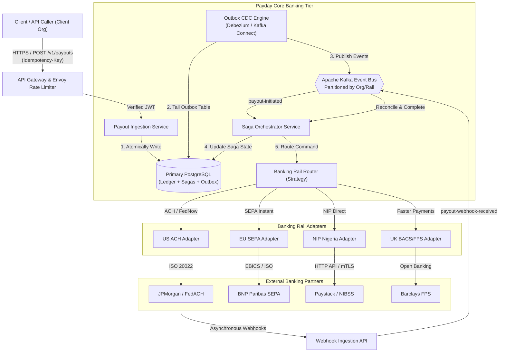
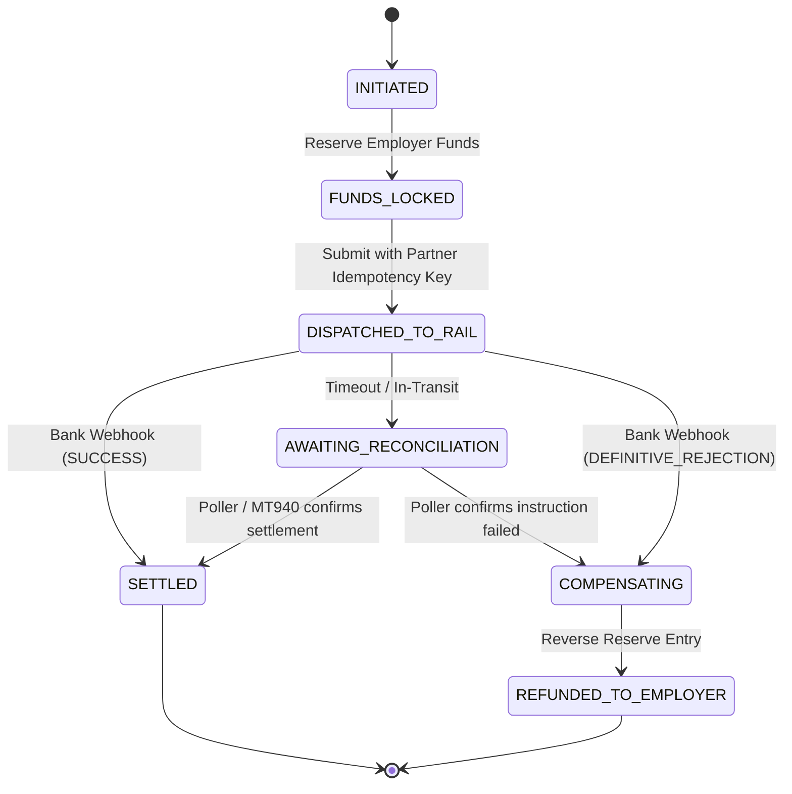
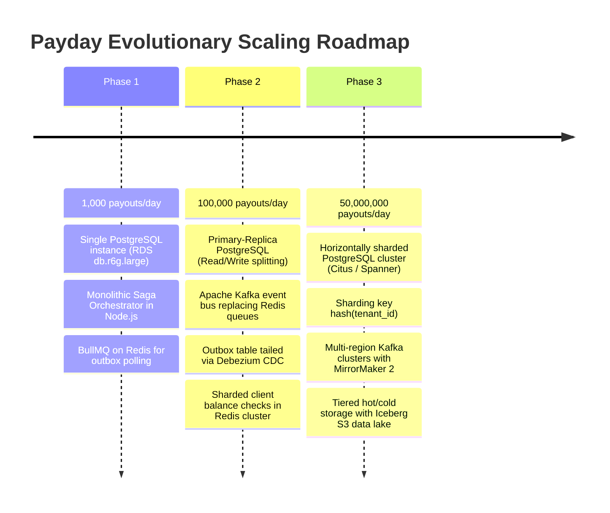

# Payday — Global Contractor Payout Platform
## Distributed System Design Document (50 Million Payouts/Day)

**Candidate:** Jesse Uwodi ([@jay-inventor007](https://github.com/jay-inventor007))  
**Target Role:** Senior Backend / Distributed Systems Engineer  
**System Name:** Payday Engine  
**Document Version:** 2.4.0 (Production Architecture Spec)  

---

## 1. Requirements

### 1.1 Functional Requirements
1. **Payout Initiation & Authorization**: Employers (clients) initiate single or bulk multi-currency contractor payouts with an explicit cryptographic `Idempotency-Key`.
2. **Multi-Currency Double-Entry Ledger**: Every fund movement is recorded as balanced debit/credit journal entries in immutable ledger tables. Stored strictly in integer minor units (e.g., cents, kobo, pence) to eliminate floating-point rounding errors.
3. **Multi-Rail Routing (Strategy Pattern)**: Dynamically route disbursements through heterogeneous banking rails (NIP/Nigeria, ACH/US, SEPA/EU, Faster Payments/UK, SWIFT/Global) based on currency, settlement latency, and fee optimization.
4. **Resilient Distributed Saga Execution**: Coordinate multi-step payout lifecycles across external banking partners without distributed two-phase commit (2PC). On bank rejection or timeout, automatically trigger compensating transactions to restore employer balances.
5. **Reconciliation & Webhook Processing**: Process asynchronous bank webhooks and daily MT940/BAI2 settlement files to reconcile final bank statuses against ledger balances.

### 1.2 Non-Functional Requirements
1. **Zero Double Disbursements (Absolute Invariant)**: Under no failure scenario (network timeouts, pod restarts, duplicate webhook retries) may a contractor be paid twice or an employer be debited without an audit record.
2. **High Throughput & Scale**: System sized for **50,000,000 payouts per day** (~578 average QPS, peak 3,500 QPS).
3. **Availability & Fault Tolerance**: 99.99% API availability. All critical external bank interactions are protected by circuit breakers and dead-letter queues.
4. **Latency SLAs**:
   - Payout acceptance & validation: `< 80ms` (P99)
   - Internal saga dispatch to bank rail adapter: `< 500ms` (P99)
   - External rail settlement: Asynchronous (depends on rail: 2s for NIP/Faster Payments, up to 48h for ACH).
5. **Auditability & Compliance**: Immutable financial records, append-only journal entries, full traceability with ISO 20022 messaging standards and PCI-DSS compliance.

---

## 2. Back-of-the-Envelope Estimations

### 2.1 Throughput & QPS
- **Daily Volume**: $50,000,000$ payouts / day
- **Average Payouts per Second**:
  $$\text{Average QPS} = \frac{50,000,000}{86,400 \text{ sec}} \approx 578.7 \text{ payouts/sec}$$
- **Peak Traffic Multiplier**: 6× peak factor during payroll cutoff windows (e.g. 17:00 WAT on the 25th of the month):
  $$\text{Peak QPS} = 578.7 \times 6 \approx 3,472 \text{ payouts/sec} \approx \mathbf{3,500 \text{ QPS}}$$

### 2.2 Storage Calculations (Double-Entry Ledger)
Every single payout creates:
1. `payout_sagas` row: ~500 bytes
2. `journal_entries` header row: ~250 bytes
3. `postings` rows (minimum 2 legs: debit employer liability, credit clearing account): $2 \times 300 \text{ bytes} = 600 \text{ bytes}$
4. `outbox_events` row: ~400 bytes
5. Total storage per payout:
   $$\text{Bytes per payout} \approx 500 + 250 + 600 + 400 = 1,750 \text{ bytes} \approx 1.75 \text{ KB}$$
- **Daily Storage Growth**:
  $$50,000,000 \times 1.75 \text{ KB} = 87,500,000 \text{ KB} \approx \mathbf{87.5 \text{ GB / day}}$$
- **Monthly Storage Growth**:
  $$87.5 \text{ GB} \times 30 \approx \mathbf{2.625 \text{ TB / month}}$$
- **5-Year Retention Storage (with Indexes & 2.5× Safety Overhead)**:
  $$2.625 \text{ TB} \times 12 \times 5 \times 2.5 \approx \mathbf{393.75 \text{ TB}}$$
  *(Solution: Sharded PostgreSQL cluster with cold data archiving to Amazon S3 Parquet via Apache Iceberg after 90 days).*

### 2.3 Network Bandwidth
- **Inbound Ingestion Payload**: $\sim 2 \text{ KB}$ per request (headers, contractor account, tax metadata)
  $$\text{Peak Inbound} = 3,500 \text{ QPS} \times 2 \text{ KB} = 7,000 \text{ KB/s} \approx \mathbf{7.0 \text{ MB/s}} \ (56 \text{ Mbps})$$
- **Internal Messaging (Kafka Outbox Topics)**:
  $$\text{Event Rate} = 3,500 \text{ QPS} \times 4 \text{ events/saga} \approx 14,000 \text{ msg/sec} \times 1 \text{ KB} \approx \mathbf{14.0 \text{ MB/s}}$$

---

## 3. API Design

### 3.1 Payout Submission Endpoint
`POST /v1/payouts`

#### Request Headers
| Header | Type | Description |
|---|---|---|
| `Authorization` | String | Bearer JWT with tenant and scope claims |
| `Idempotency-Key` | String (UUIDv4) | Mandatory unique client key for deduplication |
| `X-Tenant-ID` | String (UUIDv4) | Multi-tenant organization identifier |

#### Request Body
```json
{
  "client_reference": "INV-2026-10-OCT-882",
  "source_account_id": "acc_org_usd_01h89x",
  "destination": {
    "beneficiary_name": "Jesse Uwodi",
    "beneficiary_type": "INDIVIDUAL",
    "currency": "USD",
    "account_number": "0123456789",
    "routing_code": "021000021",
    "country": "US",
    "tax_id": "XXX-XX-8821"
  },
  "amount_minor_units": 650000,
  "currency": "USD",
  "purpose_code": "CONTRACTOR_COMPENSATION",
  "metadata": {
    "milestone_id": "ms_flutter_engine_09",
    "contract_id": "ct_fullstack_2026"
  }
}
```

#### Response (`202 Accepted`)
```json
{
  "payout_id": "pay_98f12a30_b31c_4e5d_b89a_99c32d4e8b01",
  "status": "INITIATED",
  "currency": "USD",
  "amount_minor_units": 650000,
  "estimated_settlement": "2026-10-14T12:00:00Z",
  "rail_selected": "ACH_SAME_DAY",
  "created_at": "2026-10-13T16:00:00.120Z",
  "links": {
    "self": "/v1/payouts/pay_98f12a30_b31c_4e5d_b89a_99c32d4e8b01",
    "saga_status": "/v1/payouts/pay_98f12a30_b31c_4e5d_b89a_99c32d4e8b01/saga"
  }
}
```

### 3.2 Query Payout Status Endpoint
`GET /v1/payouts/{payout_id}`

#### Response (`200 OK`)
```json
{
  "payout_id": "pay_98f12a30_b31c_4e5d_b89a_99c32d4e8b01",
  "idempotency_key": "c3e9812a-4df0-4b3e-8e4a-928d10bcf221",
  "status": "SETTLED",
  "amount_minor_units": 650000,
  "fee_minor_units": 150,
  "net_settled_minor_units": 650000,
  "rail": "ACH_SAME_DAY",
  "bank_reference": "FED_WIRE_TR_9918231",
  "timeline": [
    { "step": "SAGA_INITIATED", "timestamp": "2026-10-13T16:00:00.120Z" },
    { "step": "EMPLOYER_FUNDS_RESERVED", "timestamp": "2026-10-13T16:00:00.185Z" },
    { "step": "DISPATCHED_TO_BANK_RAIL", "timestamp": "2026-10-13T16:00:00.410Z" },
    { "step": "SETTLED_VIA_WEBHOOK", "timestamp": "2026-10-13T16:04:12.890Z" }
  ]
}
```

---

## 4. Data Model (PostgreSQL Double-Entry Ledger)

```sql
-- 1. ACCOUNTS TABLE (Double-Entry Chart of Accounts)
CREATE TABLE accounts (
    id VARCHAR(64) PRIMARY KEY,
    tenant_id VARCHAR(64) NOT NULL,
    account_number VARCHAR(32) NOT NULL UNIQUE,
    account_type VARCHAR(32) NOT NULL, -- ASSET, LIABILITY, EQUITY, REVENUE, EXPENSE
    currency CHAR(3) NOT NULL,
    current_balance_minor_units BIGINT NOT NULL DEFAULT 0,
    created_at TIMESTAMPTZ NOT NULL DEFAULT NOW(),
    updated_at TIMESTAMPTZ NOT NULL DEFAULT NOW()
);

-- 2. JOURNAL ENTRIES (Immutable Transaction Headers)
CREATE TABLE journal_entries (
    id VARCHAR(64) PRIMARY KEY,
    tenant_id VARCHAR(64) NOT NULL,
    reference VARCHAR(128) NOT NULL,
    description TEXT NOT NULL,
    created_at TIMESTAMPTZ NOT NULL DEFAULT NOW()
);

-- 3. POSTINGS (Balanced Debits & Credits)
CREATE TABLE postings (
    id BIGSERIAL PRIMARY KEY,
    journal_entry_id VARCHAR(64) NOT NULL REFERENCES journal_entries(id),
    account_id VARCHAR(64) NOT NULL REFERENCES accounts(id),
    amount_minor_units BIGINT NOT NULL, -- Positive for DEBIT, Negative for CREDIT
    direction VARCHAR(6) NOT NULL CHECK (direction IN ('DEBIT', 'CREDIT')),
    currency CHAR(3) NOT NULL,
    created_at TIMESTAMPTZ NOT NULL DEFAULT NOW()
);

CREATE INDEX idx_postings_entry ON postings (journal_entry_id);
CREATE INDEX idx_postings_account ON postings (account_id, created_at DESC);

-- CONSTRAINT: Enforce balanced journal entry sum = 0
-- (Checked transactionally in stored procedures or application saga engine)

-- 4. PAYOUT SAGAS (State Machine Persistence)
CREATE TABLE payout_sagas (
    id VARCHAR(64) PRIMARY KEY,
    tenant_id VARCHAR(64) NOT NULL,
    idempotency_key VARCHAR(128) NOT NULL UNIQUE,
    client_reference VARCHAR(128) NOT NULL,
    source_account_id VARCHAR(64) NOT NULL REFERENCES accounts(id),
    destination_payload JSONB NOT NULL,
    amount_minor_units BIGINT NOT NULL CHECK (amount_minor_units > 0),
    currency CHAR(3) NOT NULL,
    rail VARCHAR(32) NOT NULL,
    state VARCHAR(32) NOT NULL DEFAULT 'INITIATED',
    -- INITIATED -> FUNDS_LOCKED -> RAIL_SUBMITTED -> SETTLED
    -- Or on error: RAIL_REJECTED -> FUNDS_REFUNDED (COMPENSATED)
    attempt_count INT NOT NULL DEFAULT 0,
    bank_reference VARCHAR(128),
    error_message TEXT,
    created_at TIMESTAMPTZ NOT NULL DEFAULT NOW(),
    updated_at TIMESTAMPTZ NOT NULL DEFAULT NOW()
);

CREATE INDEX idx_sagas_state ON payout_sagas (state, updated_at);
CREATE INDEX idx_sagas_tenant ON payout_sagas (tenant_id, created_at DESC);

-- 5. TRANSACTIONAL OUTBOX TABLE
CREATE TABLE outbox_events (
    id BIGSERIAL PRIMARY KEY,
    aggregate_type VARCHAR(64) NOT NULL,
    aggregate_id VARCHAR(64) NOT NULL,
    event_type VARCHAR(64) NOT NULL,
    payload JSONB NOT NULL,
    partition_key VARCHAR(64) NOT NULL,
    published BOOLEAN NOT NULL DEFAULT FALSE,
    created_at TIMESTAMPTZ NOT NULL DEFAULT NOW()
);

CREATE INDEX idx_outbox_unpublished ON outbox_events (id) WHERE published = FALSE;
```

---

## 5. High-Level Architecture Diagram



---

## 6. Deep Dives into the 3 Hardest Problems

### 6.1 Non-Atomic External Banking Rail Execution & Distributed Saga State Machine
* **Problem**: In an internal database, a transaction either commits or rolls back (ACID). But when instructing an external banking rail (e.g., ACH or NIBSS), the bank is a distinct distributed actor that can return `TIMEOUT`, `PENDING_CLEARING`, or network disconnects. A simple HTTP retry could result in double-crediting the contractor.
* **Architecture Solution**:
  1. **Strict Forward/Compensating Saga Orchestrator**: The saga orchestrator runs an explicit, durable finite state machine (FSM).
     - **Forward Step 1 (Local ACID)**: Debit employer liability, credit intermediate internal `RESERVED_CLEARING` account. Record outbox event.
     - **Forward Step 2 (External Call)**: Send payment instruction to bank with a deterministically hashed `partner_idempotency_key = sha256(payout_id + rail_code)`.
     - **Resolution Path A (Success)**: Bank returns synchronous acknowledgement or asynchronous webhook. Saga transitions to `SETTLED`. Debit `RESERVED_CLEARING`, credit external bank clearing account.
     - **Resolution Path B (Definitive Bank Rejection)**: E.g., `ACCOUNT_CLOSED`, `INVALID_ROUTING`. Trigger **Compensating Transaction**: Credit employer liability, debit `RESERVED_CLEARING`. Saga marks `REFUNDED_TO_EMPLOYER`.
     - **Resolution Path C (Network Timeout / Ambiguous State)**: The saga transitions into `AWAITING_BANK_RECONCILIATION`. Never trigger compensation until either a status polling query confirms the instruction never reached the bank or 72 hours elapse and reconciliation marks it dropped.



---

### 6.2 External Banking Webhook Reconciliation & Race Conditions
* **Problem**: Bank webhooks arrive out-of-order, duplicated, or delayed by hours. A `PAYOUT_FAILED` webhook could arrive *before* the internal system even records the HTTP response from the initial submission (e.g. if the outbound HTTP connection was slow).
* **Architecture Solution**:
  1. **Monotonically Increasing State Vector**: Each saga status has a numeric sequence:
     $$\text{INITIATED (10)} \rightarrow \text{FUNDS_LOCKED (20)} \rightarrow \text{DISPATCHED (30)} \rightarrow \text{SETTLED (100) / FAILED (100)}$$
     Any webhook attempting to transition a state backwards or replay an earlier sequence is rejected as a no-op.
  2. **Webhook Cryptographic Deduplication**: Every webhook payload is fingerprinted:
     $$\text{fingerprint} = \text{HMAC-SHA256}(\text{provider} + \text{bank_ref} + \text{status}, \text{secret})$$
     Stored in a 7-day Redis deduplication ring. Duplicate webhooks receive an immediate `200 OK` without touching the ledger.
  3. **End-of-Day MT940 / BAI2 File Parser**: As a safety net for lost webhooks, Payday's overnight batch worker ingests SWIFT MT940 and BAI2 statement files directly from bank SFTP servers, reconciling any unconfirmed pending transactions against the ledger.

---

### 6.3 Double-Entry Ledger Invariant Enforcement Under High Concurrency
* **Problem**: When a large enterprise client pays 50,000 contractors simultaneously from a single master USD liability account, 50,000 threads simultaneously attempt to `UPDATE accounts SET balance = balance - amount WHERE id = 'acc_client_usd'`. Standard row-level locking (`SELECT ... FOR UPDATE`) creates massive lock contention and serial deadlocks.
* **Architecture Solution**:
  1. **Append-Only Postings (Zero Row Locking on Master Account)**:
     - The `accounts.current_balance_minor_units` column is never locked or directly updated in high-throughput hot paths.
     - Transactions insert immutable rows into the `postings` table:
       ```sql
       INSERT INTO postings (journal_entry_id, account_id, amount_minor_units, direction, currency)
       VALUES ($entry_id, $client_account_id, -650000, 'CREDIT', 'USD');
       ```
  2. **Credit Limit Check via Redis Distributed Token Bucket / Reservation Pool**:
     - The client's available balance is held in a Redis atomic structure (`INCRBY`). When a batch is submitted, Redis decrements the available balance. If balance $< 0$, the request is rejected immediately at the gateway layer *before* reaching the database.
  3. **Materialized View Snapshots**:
     - Background workers compute account balance checkpoints every 10,000 entries into an `account_snapshots` table, enabling fast point-in-time balance audits without scanning billions of rows.

---

## 7. Design Patterns (6 Explicit Patterns)

| # | Design Pattern | Component | Purpose & Implementation |
|---|---|---|---|
| **1** | **Saga Pattern (Orchestration)** | `SagaOrchestrator` | Coordinates multi-step, multi-service payout lifecycles across external banking rails without blocking distributed locks. Manages forward execution and compensating reversal entries. |
| **2** | **Transactional Outbox Pattern** | `OutboxWorker` | Eliminates the dual-write problem between PostgreSQL and Apache Kafka. The ledger posting and outbox event are written within the same atomic ACID transaction, guaranteed by Debezium CDC. |
| **3** | **Idempotent Consumer Pattern** | `PayoutIngestionService` | Dedupes requests via `Idempotency-Key` header stored in Redis with 72h TTL and enforced via a unique SQL database constraint. Replays exact previous response without re-executing. |
| **4** | **Circuit Breaker Pattern** | `BankRailCircuitBreaker` | Protects external bank rails. When a bank partner's error rate exceeds 50% over a 10-second window, the breaker trips to `OPEN`, immediately buffering outbound disbursements into a retry queue instead of hammering a failing banking partner. |
| **5** | **Strategy Pattern** | `RailRouter` | Encapsulates heterogeneous bank routing logic (`AchStrategy`, `SepaStrategy`, `NipStrategy`, `FpsStrategy`). Dynamically selects optimal strategy based on currency, amount, cutoff time, and rail health. |
| **6** | **Double-Entry Bookkeeping Pattern** | `LedgerEngine` | Core financial accounting invariant: every financial event consists of at least one debit and one credit such that $\sum \text{Debits} + \sum \text{Credits} = 0$. Eliminates phantom funds. |

---

## 8. Scaling Plan (1K → 100K → 50M Payouts/Day)



### Phase Details:
1. **Phase 1 (1,000 payouts/day — ~0.01 QPS)**:
   - Architecture: Single AWS Aurora PostgreSQL instance.
   - Orchestration: In-process Saga runner with BullMQ and Redis.
   - Operations: Direct database transactions; simple offset pagination for reporting.
2. **Phase 2 (100,000 payouts/day — ~1.15 QPS, peak 20 QPS)**:
   - Architecture: Aurora Primary + 3 Read Replicas.
   - Outbox: Debezium PostgreSQL connector streaming CDC events to Kafka.
   - Performance: Redis distributed cache for fast idempotency lookup and client balances.
3. **Phase 3 (50,000,000 payouts/day — 578 QPS, peak 3,500 QPS)**:
   - Database: Distributed database cluster sharded horizontally by `tenant_id` (Citus or Google Cloud Spanner).
   - Messaging: Multi-partition Apache Kafka cluster (64 partitions per topic) ensuring strict ordering per `tenant_id`.
   - Cold Storage: Partitions older than 90 days exported as Parquet files to AWS S3 and queryable via AWS Athena / Trino for multi-year regulatory audits.

---

## 9. Caching, Replication & Sharding Strategy

### 9.1 Redis Caching Architecture
- **Layer 1: Idempotency Cache**:
  - Key: `idemp:{tenant_id}:{idempotency_key}`
  - TTL: 72 hours (sliding)
  - Data: `{ "payout_id": "...", "status": "...", "response_hash": "..." }`
- **Layer 2: Rail Health & Circuit Breaker State**:
  - Key: `rail:health:{rail_code}`
  - TTL: 5 seconds
  - Value: `{ "state": "CLOSED|OPEN|HALF_OPEN", "failure_rate": 0.02 }`

### 9.2 Database Sharding Strategy
- **Sharding Key**: `tenant_id` (UUIDv4)
- **Hash Function**: MurmurHash3 modulo $N$ shards (initially 16 physical shards).
- **Cross-Shard Isolation**:
  - 99.8% of transactions operate strictly within the boundaries of a single tenant (Employer $\rightarrow$ Clearing $\rightarrow$ Contractor).
  - Platform-wide master settlement accounts are partitioned by currency and reconciled via independent asynchronous ledger balancing batches.

---

## 10. Failure Modes Matrix (12 Comprehensive Scenarios)

| # | Failure Scenario | Impact | Detection Mechanism | Automated Mitigation Strategy |
|---|---|---|---|---|
| **1** | External bank API returns HTTP 500 / 503 | Outbound payout blocked | Circuit breaker error counter | Trip breaker to `HALF-OPEN`; route payout to secondary fallback rail or buffer in Kafka retry topic with exponential backoff + jitter. |
| **2** | Bank connection times out after request sent | Ambiguous state: did bank debit or not? | HTTP 504 / Socket timeout | Mark saga `AWAITING_RECONCILIATION`. Block automatic retries. Trigger status polling job to bank `/v1/transfers/{partner_idempotency_key}`. Never double-send. |
| **3** | Duplicate client payout request submitted | Risk of double-paying contractor | Redis idempotency check + SQL unique constraint | Return cached original `202 Accepted` response with exact same `payout_id`. Drop duplicate invocation. |
| **4** | Outbox CDC worker crashes mid-batch | Events not dispatched to Kafka | Consumer group heartbeat loss | Kubernetes restarts pod. New worker resumes streaming from last committed PostgreSQL LSN (Log Sequence Number). Downstream consumers deduplicate via saga FSM. |
| **5** | Primary PostgreSQL database crashes | API write failure | RDS Aurora automated health check | Automated Aurora multi-AZ failover takes over within 30s. Clients receive `503 Retry-After: 5` and safely retry with idempotency keys. |
| **6** | Bank webhook arrives before saga created | Webhook cannot find parent saga | Webhook worker 404 handler | Enqueue webhook in Redis `deferred-webhooks` delay queue for 10 seconds. Re-process once initial database write commits. |
| **7** | Client account has insufficient funds | Overdraft risk | Pre-flight balance validation | Reject request synchronously at API gateway with `422 Unprocessable Entity` (`INSUFFICIENT_FUNDS`). Zero database writes. |
| **8** | Destination bank account invalid / closed | Bank rejects payout after 24h | Asynchronous webhook / MT940 file | Execute compensating transaction: Debit clearing account, credit client's master liability account. Notify client via webhook. |
| **9** | Kafka broker node failure | Event ingestion lag | Kafka cluster controller alert | Kafka topic replication factor = 3, `min.insync.replicas = 2`. Leader election takes over partition in `< 500ms` with zero message loss. |
| **10** | Clock drift across distributed nodes | Ledger timestamp inconsistency | NTP synchronization daemon alert | Use database server timestamps (`NOW()`) and monotonically increasing Postgres 64-bit sequence IDs for ordering rather than client wall-clock time. |
| **11** | Sudden traffic spike (10× payroll cutoff) | System saturation | CPU & queue depth metrics | Envoy API gateway sheds non-critical read traffic; Kafka absorbs burst; worker pods autoscale up via Kubernetes KEDA. |
| **12** | Database disk fills up on primary node | Complete outage | CloudWatch storage alarm at 80% | Auto-expanding EBS volumes + automated archiving worker compressing historical postings $> 90$ days into S3 Parquet. |

---

## 11. Architectural Trade-Offs (6 Major Decisions)

| # | Trade-Off Decision | Chosen Approach | Alternative Considered | Rationale & Justification |
|---|---|---|---|---|
| **1** | **Saga Coordination Model** | **Orchestrated Saga** (Centralized state engine) | Choreographed Saga (Decentralized event choreography) | **Why Orchestrated:** In financial payout systems, an end-to-end audit trail is non-negotiable. Choreographed sagas cause distributed state scattering and make complex compensating transactions nearly impossible to debug during audits. |
| **2** | **Transaction Consistency** | **Transactional Outbox (Eventual Consistency)** | Two-Phase Commit (2PC / XA) | **Why Outbox:** 2PC requires distributed blocking locks across databases and message brokers, crashing throughput under high QPS. Transactional Outbox provides local ACID durability with asynchronous guaranteed delivery. |
| **3** | **Balance Locking Strategy** | **Append-Only Postings + Token Bucket** | Pessimistic Locking (`SELECT FOR UPDATE`) | **Why Append-Only:** Locking a master enterprise account row blocks all concurrent payouts for that company. Append-only postings eliminate row locks entirely, achieving linear write scaling. |
| **4** | **Ledger Storage Engine** | **Relational PostgreSQL (with Citus sharding)** | Pure NoSQL Document Store (e.g. MongoDB, Cassandra) | **Why PostgreSQL:** Financial ledgers demand strict schema validation, ACID isolation, foreign key constraints, and relational consistency. NoSQL lacks the transactional guarantees necessary to prove balanced ledger accounting. |
| **5** | **Bank Rail Integration** | **BFF / Adapter Microservices with Strategy Pattern** | Third-party unified payment aggregator (e.g. Stripe only) | **Why Direct Adapters:** High-volume platforms paying 50M payouts/day cannot accept the high transaction margins of aggregators. Direct rail adapters allow zero-margin wholesale settlement and multi-rail redundancy. |
| **6** | **Idempotency Storage** | **Dual-Tier (Redis L1 + PostgreSQL L2 Unique Index)** | Single-Tier Redis Only | **Why Dual-Tier:** Redis provides sub-millisecond lookup latency, but volatile memory cannot be trusted as the ultimate financial safety net. A hard PostgreSQL unique index guarantees idempotency even if Redis experiences cache eviction. |

---

## 12. Infrastructure Cost Estimate at Scale

### Monthly Cost Model at 100,000 Active Companies (~5,000,000 Payouts/Month)
*Environment: AWS us-east-1 (Multi-AZ High Availability)*

| Infrastructure Component | AWS Service & Specification | Quantity | Unit Monthly Cost | Total Monthly Cost |
|---|---|---|---|---|
| **Compute (API & Saga Workers)** | EKS Managed Node Groups (`c6i.2xlarge` — 8 vCPU, 16GB RAM) | 12 instances | $245 / instance | $2,940 |
| **Primary Relational Database** | Amazon Aurora PostgreSQL (`db.r6g.2xlarge` — Multi-AZ, 64GB RAM) | 1 Primary + 2 Replicas | $1,280 / instance | $3,840 |
| **Distributed Message Bus** | Amazon Managed Streaming for Apache Kafka (MSK — `kafka.m5.large`) | 6 brokers (3 AZs) | $155 / broker | $930 |
| **Distributed Cache & Idempotency** | Amazon ElastiCache for Redis (`cache.r6g.xlarge` — Multi-AZ cluster) | 2 nodes | $380 / node | $760 |
| **Long-Term Cold Storage & Lake** | Amazon S3 Standard (Postings older than 90 days, Parquet) | 15 TB | $0.023 / GB | $345 |
| **Network & NAT Gateways** | AWS NAT Gateways + Inter-AZ Data Transfer | 3 AZs + 20TB Transfer | Usage-based | $1,150 |
| **Observability & Telemetry** | Datadog / AWS CloudWatch (APM, distributed tracing, metrics) | 12 hosts + logs | Flat tier | $1,200 |
| **Security & Key Management** | AWS KMS (Envelope encryption for bank credentials) + CloudHSM | Usage-based | Flat tier | $350 |
| **Total Estimated Monthly Infrastructure Cost** | — | — | — | **$11,515 / month** |

*Cost per Payout at 5,000,000 payouts/month: $\frac{\$11,515}{5,000,000} = \mathbf{\$0.0023 \text{ per payout}}$ ($0.23 cents).*
